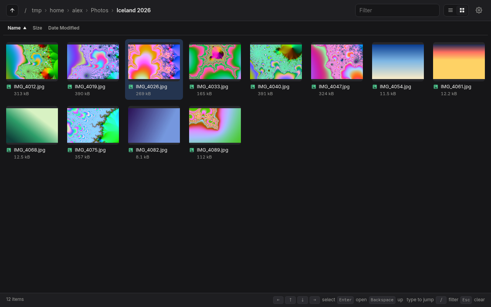
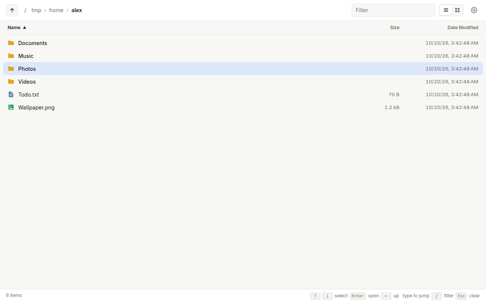
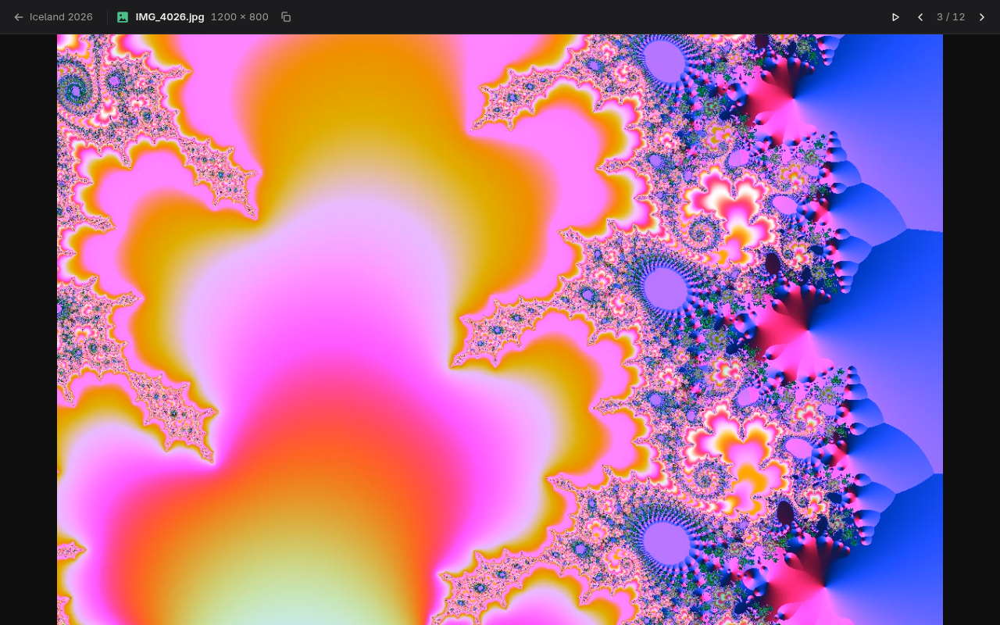
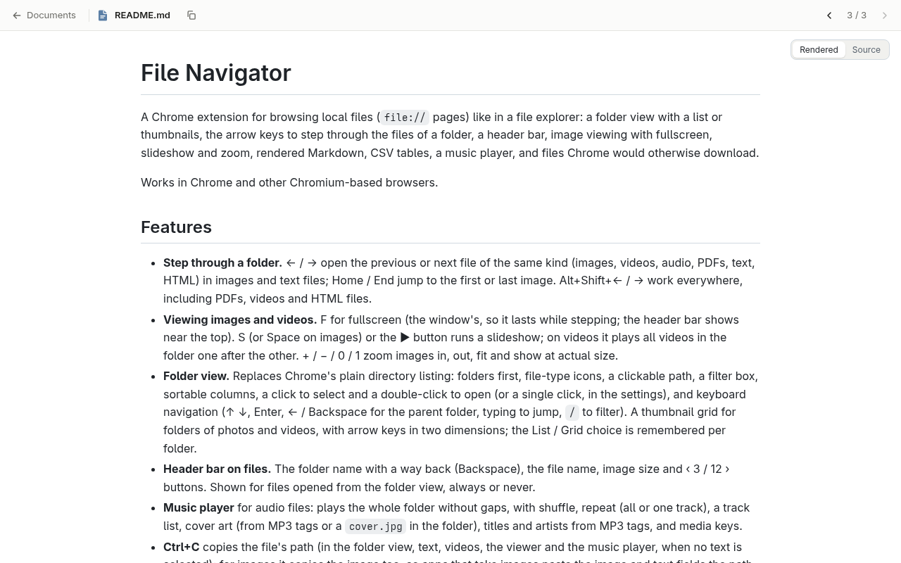
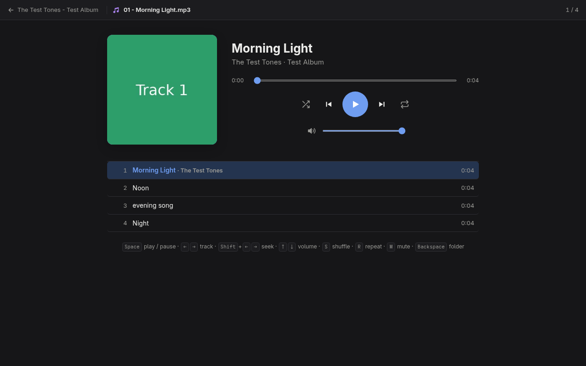

# File Navigator

A Chrome extension for browsing local files (`file://` pages) like in a file
explorer: a folder view with a list or thumbnails, the arrow keys to step
through the files of a folder, a header bar, image viewing with fullscreen,
slideshow and zoom, rendered Markdown, CSV tables, a music player, and files
Chrome would otherwise download.

Works in Chrome and other Chromium-based browsers.



| | |
|---|---|
|  |  |
| Folder view | Stepping through photos |
|  |  |
| Rendered Markdown | Music player |

## Features

- **Step through a folder.** ← / → open the previous or next file of the same
  kind (images, videos, audio, PDFs, text, HTML) in images and text files;
  Home / End jump to the first or last image. Alt+Shift+← / → work everywhere,
  including PDFs, videos and HTML files.
- **Viewing images and videos.** F for fullscreen (the window's, so it lasts
  while stepping; the header bar shows near the top). S (or Space on images)
  or the ▶ button runs a slideshow; on videos it plays all videos in the
  folder one after the other. + / − / 0 / 1 zoom images in, out, fit and
  show at actual size.
- **Folder view.** Replaces Chrome's plain directory listing: folders first,
  file-type icons, a clickable path, a filter box, sortable columns, a click
  to select and a double-click to open (or a single click, in the settings),
  and keyboard navigation (↑ ↓, Enter, ← / Backspace for the parent folder, typing
  to jump, `/` to filter). A thumbnail grid for folders of photos and videos,
  with arrow keys in two dimensions; the List / Grid choice is remembered per
  folder.
- **Header bar on files.** The folder name with a way back (Backspace), the
  file name, image size and ‹ 3 / 12 › buttons. Shown for files opened from
  the folder view, always or never.
- **Music player** for audio files: plays the whole folder without gaps, with
  shuffle, repeat (all or one track), a track list, cover art (from MP3 tags
  or a `cover.jpg` in the folder), titles and artists from MP3 tags, and
  media keys.
- **Ctrl+C** copies the file's path (in the folder view, text, videos, the
  viewer and the music player, when no text is selected); for images it
  copies the image too, so apps that take images paste the image and text
  fields the path. Browsers can't put actual files on the clipboard.
- **Markdown** is rendered (GitHub-style, with syntax highlighting for code
  blocks that name a language), with a switch to the source.
- **CSV and TSV** open as tables (delimiter detection, number columns,
  a header that stays in view), with a switch to the source.
- **Files Chrome would download** open anyway: text formats like YAML, TOML
  and SQL in a text viewer, and `.mov` videos in a video player.
- **Settings** for sort order, grouping, hidden files, wrapping around, the
  position label, the header bar and the default Markdown and CSV views.

## Install

From the Chrome Web Store (in review), or from a release zip or this folder:

1. Download `file-navigator-<version>.zip` from the
   [releases](https://github.com/lendev4/file-navigator/releases) and unzip it,
   or clone this repository.
2. Open `chrome://extensions`, turn on **Developer mode**, click **Load
   unpacked** and choose the folder.

Then open the extension's **Details** and turn on **Allow access to file
URLs**. Without it the extension can't do anything on local files.

Click the toolbar icon (or press Alt+Shift+E) to open the folder view: in the
start folder from the settings, else the last folder you browsed, else your
home folder. The settings are in the icon's right-click menu (Options) and
behind the ⚙ button in the folder view. Shortcuts can be changed at
`chrome://extensions/shortcuts`.

## Known limitations

- Whether Chrome shows or downloads a file depends on the file type your
  system reports for its extension. The lists in `shared.js` were checked on
  Linux; other systems may differ.
- Files Chrome downloads are only redirected when opened through the extension
  (folder view, stepping, links in Markdown). Typing their path into the
  address bar still downloads them. Markdown is the exception: Chrome shows it,
  so the extension can move it to the viewer.
- Plain arrow keys aren't used on videos (they seek), PDFs (the viewer takes
  them) and HTML pages (the page may use them); use Alt+Shift+← / →.
- SVG files are shown like other images, so scripts or animations in them
  don't run.
- Code files (`.py`, `.js`, …) use Chrome's own text view, without syntax
  highlighting.

## Development

The extension is plain JavaScript with no build step. Third-party libraries
are in `vendor/` (see `vendor/README.md`); `test-files/` has files of every
supported kind for trying things out.

| File | Does |
|---|---|
| `background.js` | Works out the previous/next file, navigates tabs, remembers files opened from the folder view |
| `offscreen.js` | Reads Chrome's directory listing pages (the background worker can't load `file://` URLs) |
| `content.js` | Keys, header bar and position label on file pages |
| `listing.js`, `listing.css` | The folder view |
| `viewer.html`, `viewer.js`, `viewer.css` | The viewer for Markdown, CSV and files Chrome would download |
| `options.*` | The settings page |
| `shared.js` | File types, settings and URL helpers used everywhere |

### Release

1. Raise `version` in `manifest.json` and commit.
2. `./build.sh` makes `dist/file-navigator-<version>.zip` from the committed
   files, without tests, test files and store assets (see `.gitattributes`).
3. Optionally run the tests against the zip:
   `unzip -d /tmp/fn dist/file-navigator-<version>.zip && EXTENSION_PATH=/tmp/fn npm test` in `tests/`.
4. Upload the zip in the Chrome Web Store developer dashboard. The listing
   texts, permission justifications and images are in `store/`
   (`mise exec -- npm run store` in `tests/` regenerates the images).

### License

MIT, see [LICENSE](LICENSE). The bundled libraries in `vendor/` keep their own
licenses.

### Tests

Browser tests drive a headless Chromium-based browser with the extension
loaded. Node and ffmpeg (for making test videos) come from [mise](https://mise.jdx.dev/):

```sh
mise install
cd tests
npm install
npm test             # all tests
npm test markdown    # tests whose suite or name contains "markdown"
```

The tests look for Helium, Chrome or Chromium; set `CHROME_PATH` to use
another browser. After editing `icons/icon.svg`, run `npm run icons` in
`tests/` to re-render the PNG icons.
